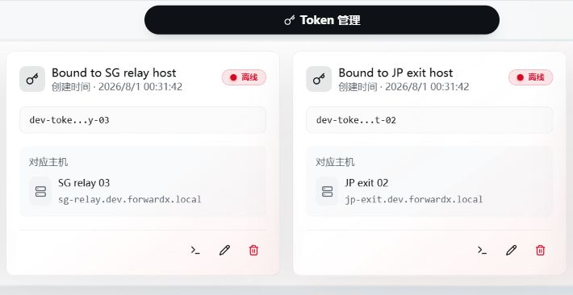

# 安装与维护 Agent

Agent 安装在被管理的 Linux 主机上，执行转发配置、上报状态和流量、完成网络测试。实际转发由 Agent 与对应运行时完成，不是由面板服务器中转。

## 1. 创建独立 Token

进入「主机管理 → Token 管理」，创建 Token，再复制对应的安装命令。

**每个 Token 只绑定一台主机**。多台主机分别创建，不影响加入同一转发组、入口组或出口组。Token 泄露后应吊销并重新创建，不能公开截图或发送完整配置。



## 2. 安装并确认在线

在被管理主机以 root 执行面板生成的命令，例如：

```bash
curl -fsSL https://panel.example.com/api/agent/install.sh | bash -s -- install YOUR_AGENT_TOKEN
```

替换实际面板地址和 Token。安装命令默认采用配置的公开地址；需要其他可达入口时，在安装命令弹窗核对地址来源。安装后在主机列表确认在线及环境检测结果。

前置要求：Linux、root、可访问面板，以及到下载源/系统软件源的网络。Agent 不支持将 Windows 作为被控运行环境。安装器会检测架构并安装相应资产；不要把不支持的系统或 libc 强行套用其他二进制。

安装器默认选择兼容的 Realm `2.9.4`，其他版本可通过 `FORWARDX_REALM_VERSION` 显式选择。iperf3 仅用于网络测试，安装失败会警告，不应阻断 Agent 主流程。

## 3. SOCKS / HTTP 代理（可选）

需要使用代理时，下载入口脚本与安装执行均需设置：

```bash
curl --proxy 'socks5h://127.0.0.1:1080' -fsSL \
  https://raw.githubusercontent.com/owo10086/sni-panel/main/scripts/install-agent.sh \
  -o /tmp/forwardx-install-agent.sh

PANEL_URL='https://panel.example.com' bash /tmp/forwardx-install-agent.sh \
  install YOUR_AGENT_TOKEN --proxy 'socks5h://127.0.0.1:1080'
```

新版 Agent 的运行配置为 `/etc/forwardx/agent/config.json` 中的 `proxyUrl`。代理覆盖注册、心跳、上报、事件流与下载/升级，**不代理业务转发和 ping/tcping/iperf**。

已有新版 Agent 可添加该字段并重启；清空或删除后重启即直连，不继承系统代理环境变量。旧版 Agent 必须先升级。认证、远端 DNS、包管理器限制和完整方法见 [代理专题](./agent-proxy-manager.md)。

## 4. 使用 SSH 菜单

包含此功能的新版安装器会注册 `fwxm`。直接输入打开菜单：

```bash
fwxm
```

> 如果面板地址变化导致 Agent 离线，重新执行带正确面板地址的安装或升级命令即可恢复连接。

### GOST 业务的升级影响

GOST 保留已有连接的新增方式需要本项目 Agent **3.3.0 或更新版本**。旧版 Agent 3.2.0 仍能使用新面板，但新增规则会沿用旧的共享服务重启方式；不能仅凭版本数字高于上游版本就认为已具备这项能力。

首次启用这项能力时，共享 GOST 服务需要重启一次，已有连接会断开，请安排在能接受短暂中断的时间。启用完成后，只新增监听及其所需配置时，原来的监听和连接继续运行；新增端口冲突或应用失败只撤回本次新增。

例如，主机上的 A、B 两条 GOST 业务正在使用，新增 C 成功后 A、B 的连接继续；C 端口被其他程序占用时，撤回 C，A、B 仍可使用。修改已有配置、删除监听或恢复已停止的服务，仍采用重建方式，相关共享服务中的连接可能断开。本地控制通道仅限主机 root 使用，无需开放新的管理端口。

---

## 卸载 Agent

卸载命令可在 Token 管理的安装命令弹窗中获取，通用卸载命令如下：

```bash
curl -fsSL https://raw.githubusercontent.com/owo10086/sni-panel/main/scripts/install-agent.sh | bash -s -- uninstall
```

`proxy set` 支持隐藏输入，`set/off` 保存后重启 Agent。信息/代理查看会隐藏凭据，不建议用 `cat config.json` 向他人提供排障数据。

旧部署没有管理命令时可用原生命令：

```bash
systemctl status forwardx-agent --no-pager -l
tail -n 300 /var/log/forwardx-agent/agent-go.log
systemctl restart forwardx-agent
```

非 systemd 主机用 OpenRC / SysV 对应服务命令。

## 5. 升级与修复

可在主机管理页面选择单台或批量升级，也可在该 Agent 主机执行：

```bash
fwxm agent upgrade
```

升级复用 Token 和配置代理，无需再次填写凭据。旧版可从当前可达面板下载升级入口：

```bash
curl -fsSL https://panel.example.com/api/agent/install.sh | bash -s -- upgrade
```

已有代理时优先使用 `fwxm`；直接运行上面的下载命令时，前面的 curl 也必须单独设置代理。面板地址变化、离线时请明确指定正确入口，不要指望只修改面板公开地址就能通知失联主机。

`fwxm agent repair` 保留配置，重新下载安装当前可用版本并重启，可能升级版本，不等同于只重启。升级或修复运行时不保证业务连接不断；跨面板迁移请用 [迁移流程](./migration.md)，不要先卸载。

## 6. 卸载

```bash
fwxm agent uninstall
```

需要交互确认，会停止受管转发。管理命令调用缓存入口执行本地清理，不要求面板在线；旧版可先下载 GitHub 入口脚本，再运行 `uninstall`。详见 [卸载与数据保留](./uninstall.md)。

## 文件与日志

| 用途 | 默认路径 |
| --- | --- |
| 通信、Token 和代理配置 | `/etc/forwardx/agent/config.json` |
| Agent 程序 | `/usr/local/bin/forwardx-agent` |
| FXP / GOST 运行时 | `/usr/local/bin/forwardx-fxp` / `/usr/local/bin/forwardx-runtime` |
| 常规日志 | `/var/log/forwardx-agent/agent-go.log` |
| 自升级安装日志 | `/var/log/forwardx-agent/agent-upgrade.log` |
| 持久化状态 | `/var/lib/forwardx-agent/` |
| 临时运行态 | `/run/forwardx-agent/` |
| GOST 配置 | `/etc/forwardx/runtime/` |
| SSH 管理辅助脚本 | `/etc/forwardx/manage/` |

历史路径 `/etc/forwardx-agent`、`/etc/forwardx-runtime`、`/etc/forwardx-tunnel-runtime`、`/etc/forwardx-gost`、`/etc/forwardx-tunnels` 可能存在，升级会处理相应迁移。不要手动清空整个 `/etc/forwardx`；同机可能还有面板管理配置。

日志有大小限制，详细会话日志仅用于短时排障。Agent 离线时先核对面板 URL、代理连通性、证书及日志；安装失败看第一个真实错误，升级失败还要看 `agent-upgrade.log`。目录、日志与资源排障见 [运维目录](./paths-logs.md) 和 [常见问题](./troubleshooting.md)。

## mimic UDP 混淆（可选）

仅显式启用 ForwardX 隧道混淆时需要；普通转发不依赖 mimic。安装器默认询问，回车跳过，输入 Y 才安装。当前目标 `mimic v0.7.1`，需要 Linux 6.1+ 与相应 XDP/TC 内核能力。

缺少依赖时面板会阻止启用并提供安装提示；Agent 不会因运行中的混淆开关自动安装内核组件。详见 [部署准备](./preparation.md) 和 [隧道](./tunnels.md)。

## SSH 管理与代理

包含本轮功能的安装器会登记 `fwxm`。同机有面板和 Agent 时明确选择对象；例如 `fwxm agent status`、`fwxm agent proxy set` 和 `fwxm agent proxy off`。代理修改会重启 Agent，需要重新确认 SNI 当前配置。完整说明见 [SSH 管理](./ssh-management.md)和[代理设置](./agent-proxy-manager.md)。
