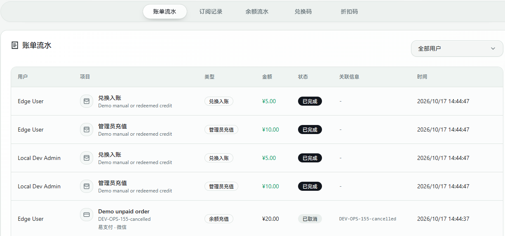
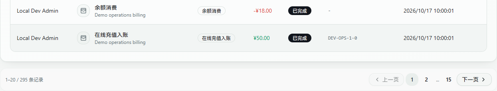

# 账单与兑换

管理员在「账单与兑换」统一查询订单、订阅及余额流水，管理兑换码和折扣码。支付通道配置与测试下单放在 [支付对接](./payments.md)，不再重复展示订单列表。

## 查询流水

| 页签 | 内容 | 每页数量 |
| --- | --- | --- |
| 账单流水 | 支付订单、余额变动、订阅记录，支持按用户筛选 | 20 条 |
| 订阅记录 | 当前查询范围内的套餐订阅 | 20 条 |
| 余额流水 | 充值、消费、兑换和管理员调整 | 20 条 |
| 兑换码 | 按全部、未使用、已使用筛选 | 50 个 |
| 折扣码 | 优惠类型、适用套餐、次数和有效期 | 50 个 |

记录超过一页时，列表下方显示总数、页码与上一页/下一页；页码在当前浏览器保留。账单用户筛选改变后回到第一页。分页由服务端查询当前页，不会只截取最近 100/200 条而丢掉更早记录。

账单中的支付订单与对应余额入账是不同来源的记录，可能同时出现，不能直接相加作为收入。查看日期范围内的实收及消费构成，可使用 [运维看板](./operations.md#账务汇总)。

普通用户从自己的钱包/账单、订阅及商店查看和操作个人业务，不能进入管理员的全用户账单、兑换码和支付配置管理页。

*上游开发演示，图中为演示用户和订单；仅截取列表上部，分页控件位于完整列表下方。*

*上游开发演示，底部分页可直接跳页，不需要加载全部记录。*

## 核对一笔支付

1. 在「账单流水」选择所属用户，按事件时间找到订单。
2. 核对面板订单号、金额、币种、支付通道和网关流水；已付款订单可查看支付时间。
3. `pending` 是待支付；`paid` / `processing` 表示收款已确认但权益尚未完成发放；只有 `completed` 表示发放完成。
4. 订单有异常提示时，按订单号搜索面板 `[Payment]` 日志，并核对支付平台的实际收款记录。详见 [订单状态与恢复](./payments.md#订单状态)。

测试订单也在账单中保留，但不计入运维看板的正式在线实收。没有异常提示不等于交易成功；不能根据浏览器返回成功页手工认定入账。

## 管理余额

在「用户管理」找到目标用户，使用充值或设置余额操作。充值是在现有余额上增加金额；设置余额将余额改为指定值，并记录差额流水。操作前核对用户和金额单位。

管理员充值、兑换、余额扣款和在线充值分别记录来源。主机「用量修正」、用户「重置流量」不会撤销已有余额扣款，不应拿它们当退款工具。

## 发放兑换码

1. 在本页开启「兑换入口」后，进入「兑换码」页签。
2. 选择套餐兑换或余额兑换。套餐需选择套餐和时长；余额需填写大于 0 的金额。
3. 填写自定义码或留空生成随机码，设置数量、生效时间和过期时间，生成后复制或导出。
4. 将码交给目标用户，由用户在自己的兑换入口提交；用管理员列表的已使用状态核对结果。

一批最多生成 500 个。兑换码相当于可领取权益的凭证，不要放入公开截图、仓库或聊天群。删除已使用兑换码不会回滚已完成的兑换；关闭兑换入口会阻止新的兑换，不撤销已发放权益。

## 创建折扣码

1. 开启「购买折扣入口」，进入「折扣码」页签。
2. 选择百分比或固定金额优惠，填写折扣值、最多使用次数（0 表示不限）、可用时间及适用套餐。
3. 用户在支持折扣的套餐购买/续费流程中输入码，核对优惠预览后再支付。

百分比填写的是**减免比例**：输入 `20` 表示减免 20%，原价 100 元应付 80 元，不是“二折”。固定金额填写的是页面显示的货币金额，不是数据库的分值；最终金额不会小于 0。未限定套餐时仍受页面与后端的适用校验约束。

下单会预占使用次数，未付款失败/过期后释放；延迟付款恢复时会重新检查额度，不能保证释放后的名额永远为原订单保留。不要删除优惠配置后再假定所有旧订单一定可自动恢复。

## 常见问题

- 找不到旧订单：检查用户筛选和页码；已取消套餐保留在账单历史中，不一定出现在当前订阅列表。
- 加载后只剩空表头：先看浏览器网络请求和面板日志，区分请求失败与确实无记录；本地开发新增接口后需重启后端，见 [开发排障](./development.md#接口更新与加载排障)。
- 已收款但没有余额/套餐：先核对支付状态及异常提示，不要反复手工加余额后重放回调；按 [支付排障](./payments.md#排查顺序) 处理。
