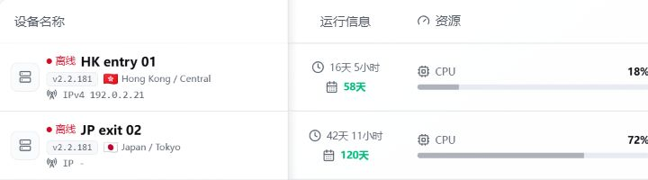
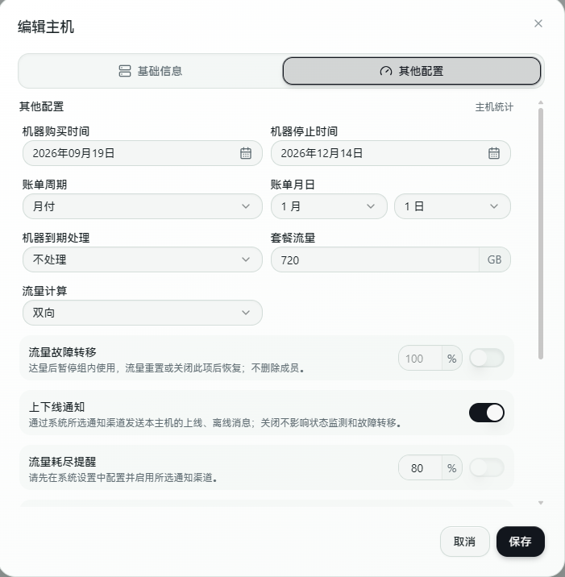

# 主机管理

主机管理用于查看和维护所有已接入的 Agent 主机。

## 主机列表

主机列表展示每台主机的实时状态，包括：

- **在线/离线状态** — 绿色表示在线，红色表示离线。
- **延迟** — 面板与 Agent 之间的往返延迟，反映连接质量。
- **Agent 版本** — 当前运行的 Agent 版本号。
- **CPU、内存、磁盘占用** — 主机资源使用情况。
- **系统负载** — 系统平均负载。
- **公网 IPv4 / IPv6** — Agent 检测到的公网地址。
- **内网 IP** — 主机内网地址。
- **网卡信息** — 网络接口列表。
- **转发状态** — 当前转发规则的运行情况。
- **流量数据** — 累计上下行流量统计。



## 在线与离线

绿色表示在线，红色表示离线。

如果主机离线，常见原因：

- Agent 服务没有运行。
- Agent 配置中的面板地址不对。
- 面板域名、端口或反向代理不可访问。
- 服务器防火墙阻止连接。
- 面板公开地址修改后，Agent 还在使用旧地址。

在 Agent 主机上可以查看日志排查：

```bash
journalctl -u forwardx-agent -n 300 --no-pager
```

Agent 配置文件位于 `/etc/forwardx/agent/config.json`，日志目录位于 `/var/log/forwardx-agent/`。

### 上下线通知

管理员可在「编辑主机 → 其他配置」设置「上下线通知」，新建主机和已有主机默认开启。实际推送仍需在系统设置启用所选通知渠道（Telegram / Discord）及主机上下线通知，并由管理员绑定对应账号。

关闭期间不再推送该主机的上线、离线消息，发送前也会检查开关以屏蔽排队中的离线提醒；不影响在线状态、离线历史、故障转移及流量/续费提醒。重新开启不会主动补发已跳过的消息。



*上游开发演示：上下线通知已开启；流量故障转移和流量耗尽提醒为不同设置。*

## 主机信息维护

建议给每台主机填写清晰的名称，例如：

```text
香港入口-1
日本落地-1
美国中转-1
```

也可以设置：

- **备注** — 记录主机用途或额外说明。
- **手动入口 IP 或域名** — 覆盖自动检测的公网地址。
- **DDNS 域名** — 绑定动态域名，支持 DDNS 故障转移。
- **网卡名称** — 指定流量统计所使用的网卡。

主机名越清楚，后续创建转发规则、隧道和链路时越不容易选错。

## 用户授权与主机可见性

在「用户管理 → 授权」分别配置端口转发、转发链/转发组和隧道的使用权限，不以是否分配成员主机代替资源授权。普通用户可能通过有效套餐或按量计费产品获得使用权限，不一定需要逐台手动授权。

网络测试的主机列表另外受主机权限控制：用户自有、通过主机授权或有效套餐授权获得的主机可见；仅有链路使用权限，不会让其成员主机单独出现在网络测试中。管理员可管理全部主机。

完整操作及撤销授权后的规则行为见 [用户、套餐和权限](./users-billing.md#权限分配)。

## NAT 主机与可用端口

NAT 主机应在主机配置中填写供应商实际映射的可用端口范围，TCP / UDP 分别按供应商能力放行。范围配置只限制面板分配，不会替你创建供应商的 NAT 映射或修改安全组。

业务入口、隧道承载监听与部分模式的规则出口监听可能是不同端口。需要规则独立出口端口的模式会占用额外端口；不要把“隧道测试通”当作业务端口已经映射。Nginx Stream 隧道规则复用该隧道的监听端口；变更模式后检查实际规则端口与运行状态。

## 流量故障转移

在主机编辑的「其他配置」设置大于 0 的套餐流量、计量方式，再开启「流量故障转移」并设置阈值（1%–100%）。达到阈值后，主机暂停参与转发组、入口组和出口组调度，不删除组成员，也不改变 Agent 在线状态。

计量按当前周期的主机流量与所选方式计算，见 [流量口径](./traffic-latency.md)。重置流量、提高额度使其低于阈值，或关闭开关后重新参与调度；恢复依赖面板重新计算与 Agent 同步。没有可用备用成员时，排除主机并不保证业务可继续，需提前配置备用路径。

此开关不是单条规则额度或账户额度，也不是主机断电开关；不要用它代替 [单规则限额](./rules.md#单条规则限额与有效期)。

## 用量修正

管理员在主机操作菜单选择「用量修正」，弹窗默认填入当前统计的已用流量。核对主机和当前计量方式，输入修正后的总用量（GB，不能小于 0），点击「保存修正」。输入的是新的累计值，不是本次增减量。

后续上报在修正后的用量上继续累计。此操作只修正面板的主机累计用量，不修改 Agent 系统累计流量，也不替代用户流量重置或账务退款。若开启了流量故障转移，修正后还应核对是否达到调度阈值。

## 安全移除主机

先从转发组、转发链、入口组 / 出口组与隧道中移除对应成员。保存成员变更会同步模板引用，未改变的健康成员规则保留；仍有真实依赖时，删除弹窗会列出关联资源及处理入口。

在线主机需等 Agent 完成清理；离线清理必须明确确认，不会绕过真实依赖。移除面板记录不会停止离线主机上的程序，需要自行停止或卸载 Agent。预览只显示有权查看的名称，其他人的关联配置由管理员处理；最终删除会再次检查当前引用、归属与在线状态。若只修改了业务目标而未移除资源成员，仍不能直接删除主机。

## 主机排序

主机管理中的排序通过拖动完成，不需要手动填写排序数字。

- **无分组时** — 在主机列表中直接拖动调整顺序。
- **有分组时** — 「全部」视图按分组顺序汇总展示，不支持直接拖动。切换到具体分组后，只调整该分组内的主机顺序。
- 主机分组、Agent Token 和主机探测服务也支持拖动排序。

## mimic 环境检测

mimic 是基于 eBPF 的 UDP 混淆方案（来自 [hack3ric/mimic](https://github.com/hack3ric/mimic)，GPL-2.0-only，当前版本 v0.7.1），需要满足特定的内核与权限条件。面板会自动检测每台主机的 mimic 运行环境，并在主机列表中显示检测结果：

| 状态 | 含义 |
|------|------|
| 支持 | 内核版本 ≥ 6.1，XDP 入站和 TC 出站 eBPF 钩子可用，可正常使用 mimic |
| 内核版本不足 | 当前内核版本低于 6.1，不支持所需的 eBPF 特性 |
| eBPF 不可用 | 系统未加载必要的 eBPF 模块或缺少相应权限 |
| 未检测 | Agent 版本过旧或检测尚未完成 |

如果需要使用 mimic UDP 混淆功能，请确保主机内核版本不低于 Linux 6.1，并确认 XDP 入站和 TC 出站 eBPF 功能可用。Agent 会在 XDP `native` 与 `skb` 模式之间自动回退，无需在面板手动切换。

## IPv6 检测

如果 IPv6 地址检测不到，先确认服务器自身是否有可用 IPv6：

```bash
ip -6 addr show scope global
ip -6 route
ping -6 -c 4 2606:4700:4700::1111
```

如果服务器只有内网 IPv6 或 IPv6 不可出站，面板可能无法将其作为可用入口展示。

## 流量故障转移

主机设置中可以启用“流量故障转移”，并设置 1—100% 的阈值，默认关闭、默认阈值为 100%。只有开启且主机流量限额大于零时才生效，使用主机已有的上下行、出站或较大方向计量口径。

达到阈值后，该主机暂时退出转发组、故障转移和隧道入口/出口组。保存的成员、端口和启用配置保留；流量重置或关闭开关后重新参与，仍须满足其他健康和权限条件。固定链的必要中继或出口不可用时，相关链暂停，面板不会绕过固定节点。

## 从组中移除后删除主机

保存成员列表后，系统会解除已移除主机在该组中的规则引用，并通知旧主机清理对应配置。原有业务规则和用量记录继续保留。

例如，入口组由 A、B 改为只保留 B，引用它的转发链会改用 B；如果 A 没有其他用途，就可以正常删除。若 A 还被其他组使用，或仍是某条独立隧道的入口、中继、出口，需要先解除那项引用。

旧主机离线时，面板中的引用可以先释放，实际配置撤除需要等它重新连接。成员保存成功也不代表 DNS 和业务连接已经切换完成，应分别查看健康状态和解析结果。

详见[转发组和入口组的成员管理](./groups.md#成员管理)。
