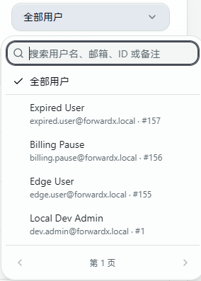

# 界面与常用操作

本页说明面板网页，桌面和手机浏览器均可使用。截图可能来自旧版，操作时以当前页面的字段和校验提示为准。

## 语言与主题

- 右上角选择「简体中文」或「English」。首次使用按安装参数、浏览器语言和已有地区提示决定默认语言；手动选择保存在当前浏览器，优先生效。
- 深浅色模式在右上角切换，个性化设置用于调整配色、壁纸等；网络测试输出也跟随主题。
- 辅助说明默认收起，点击「使用说明」「统计口径」等标题展开。风险提示、归属与限额仍单独展示。
- 窄屏或英文标签较长时，页签可横向滚动，操作区会换行。系统开启“减少动态效果”时，面板减少展示动效。
- 统计和产品卡片在鼠标悬停时轻微上浮并突出边框、阴影；触屏不启用悬停动效，系统开启“减少动态效果”时取消位移动画。拖拽卡片仅突出边框和阴影，不影响拖动。
- 左侧菜单滚动后切换页面会保留菜单位置，不主动跳回顶部。手机端菜单使用抽屉式展开，选择页面后收起。

## 用户选择与长列表

运维看板、转发规则、账单筛选及套餐分配使用可搜索的用户选择器。打开时先显示一页用户，支持直接选择；输入用户名、邮箱、ID 或备注可搜索，通过上一页/下一页继续查找，已选用户不因搜索或翻页而丢失。

「全部用户」「管理员/当前用户」等范围选项按所在页面提供。选定用户会影响业务归属或统计范围，提交前请核对，不能把筛选项当成授权开关。

*上游开发演示；图中用户名和邮箱均为演示数据。*

账单与余额流水每页 20 条，兑换码与折扣码每页 50 个，使用列表底部分页，不需要无限向下滚动。详细操作见 [账单与兑换](./billing.md)。

## 规则归属与筛选

管理员默认查看「我的规则」。切换指定用户后，添加规则、批量管理和重置操作按该用户范围执行；在「所有用户」下新增规则，默认仍归管理员本人。

规则分类按「全部、端口转发、隧道转发、转发链、转发组、sni规则组」排列；SNI 只在最后一类中查看，「全部」排除 SNI。再选择具体链路时保留 SNI 分类。搜索可以匹配名称、端口、目标以及关联主机地址；列表、数量和汇总按相同筛选范围展示，SNI 翻页保持完整分组。打开批量管理不会清空背后的规则列表。

复制前核对弹窗里的目标资源和所属用户。跨资源复制不继承目标资源不支持的专有参数。详细权限与限额见 [转发规则](./rules.md)。

## 设置入口

| 需求 | 入口与文档 |
| --- | --- |
| 面板公开地址、登录人机验证 | 系统设置 → 系统配置；[首次初始化](./first-setup.md) |
| Google 登录 | 系统配置底部的 Google 账户登录卡片；[配置说明](./google-login.md) |
| 支付通道和测试下单 | 支付对接；[通道配置](./payments.md) |
| 订单、余额、兑换码与折扣码 | 账单与兑换；[使用教程](./billing.md) |
| 运维图表和自动刷新 | 运维看板顶部筛选区；[看板教程](./operations.md) |
| 单台主机上下线提醒 | 编辑主机 → 其他配置 → 上下线通知；[主机管理](./hosts.md#上下线通知) |
| Telegram / Discord | 系统设置中的通知渠道配置；[通知说明](./notifications.md) |
| 单条规则的限速、流量和到期日 | 管理员添加/编辑规则 → 展开「限额与有效期」；[规则限额](./rules.md#单条规则限额与有效期) |
| 用量、延迟、探测失败率 | 规则/主机详情或图表；[统计口径](./traffic-latency.md) |
| 备份与迁移 | 系统设置中的备份恢复、迁移功能；[升级备份](./upgrade-backup.md)、[迁移](./migration.md) |

「开源与联系」保留在系统配置最底部。未显示某项功能时，先检查当前账号权限、所选资源类型与 Agent 版本，不要仅凭截图判断配置丢失。

## 管理员与普通用户

管理员为用户创建或配置限额的规则，用户可以查看用量，但不能编辑、启停、删除或重置。管理员自己的规则也可配置独立额度，适合分享单条规则而不另建账号。

账户授权、套餐配置和展示说明统一见 [用户与套餐](./users-billing.md)。
