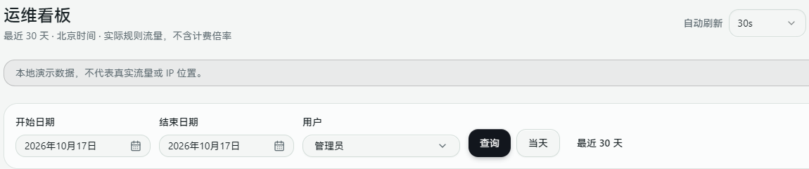
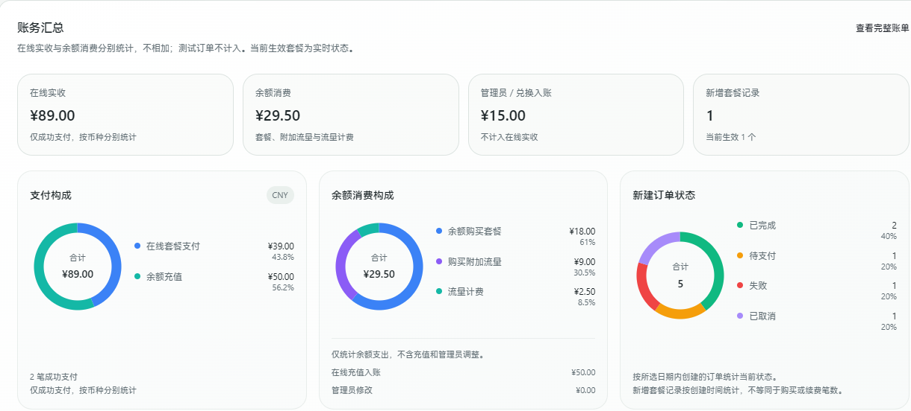

# Operations dashboard

[简体中文](./operations.md)

Administrators can open **Management → Operations** to view today or a date range within the last 30 days. Calendar days use **Beijing time (UTC+8)**.

Select 5s, 10s, 30s or Off beside Refresh. The default is 30s, remembered per account in this browser. Traffic, source IPs, finance and open details share the selected interval. Refresh pauses when you leave the dashboard or hide the tab, and resumes when you return. Off still allows manual refresh and queries after changing filters.

This interval controls browser reads, not aggregate recomputation. Traffic trends/rankings and financial summaries refresh in the background about once a minute; repeated reads reuse the result for the exact account/date scope. A new scope is computed on first access. Global resource monitoring, source-IP lists and paginated ledgers retain their own query/refresh behavior. Balance checks and billing remain live.

## Quick workflow

1. Select the Beijing-time date range and user. **Admin** covers only the current administrator's account; choose all users for site-wide totals.
2. Choose a refresh interval, or Off to inspect a stable snapshot and refresh manually when needed.
3. Review traffic trends and rankings. For finance, select the payment currency and read payment composition, wallet spending and new-order statuses separately.
4. An empty ring means no matching data, not a failed request. Check page errors and API responses for failures, and inspect original records in the [billing guide (Chinese)](./billing.md) before judging an order from a summary.



*Upstream development demo in Chinese: current administrator, today's date and a 30s refresh interval.*

## Daily operations reports

Open **Settings** at the top right to enable reports and choose a send time. Reports are disabled by default; the default time is **00:00 Beijing time (UTC+8)**. They use the active Telegram or Discord channel and go to enabled administrators linked to that channel.

Each report covers the previous complete calendar day across all users, regardless of dashboard filters: actual traffic, top three users/rules, top three offline durations, and online receipts separated by currency. The online-host count reflects send time. Only collected data is included; traffic excludes billing multipliers.

Enabling or changing the time after today's scheduled time starts delivery tomorrow. A restart catches up today's unfinished report only, not a backlog of old days. Failures retry after about five minutes without resending successful recipients. Delivery continues with the browser closed; local development mode disables background tasks by default.

## Traffic and history

View incoming/outgoing rule traffic, daily trends, and rankings by user, host, logical rule and resource. Multi-entry members are combined under their logical rule. Existing accounting-host selection prevents relay hops from being counted twice.

The dashboard defaults to **Admin**, meaning the current administrator's account. Choose all users or a specific user to filter trends, rankings, the source map and IP details together. Host health and group events are limited to resources associated with that user's rules.

Totals are actual rule traffic, without billing multipliers; they are not host NIC totals. Observed host downtime and forwarding-group events are also shown. The online-host count is current, not historical.

Daily summaries stay in the configured database for up to 30 calendar days. Collection starts after upgrading; earlier history is not backfilled. Stored summaries remain until expiry even if a rule is deleted.

Full backups include source IP history and should be protected accordingly. Essential/configuration-only migration omits these operational histories.

## Billing overview

Billing follows the same date and user filters, defaults to **Admin** (the current administrator's account), and is admin-only.

- Online receipts include successful production top-up and plan payments, grouped by currency without conversion. Test, pending, cancelled and failed orders are excluded.
- Receipts use the payment date, falling back to creation time for legacy orders without a payment timestamp. New-order statuses use creation time, so their counts may differ.
- Wallet spending separates plan purchases, traffic add-ons and metered traffic. A payment and its wallet credit are not two revenues; traffic billing uses wallet deductions without recounting billing detail records.
- Static donut charts show payment composition, wallet spending and new-order statuses, including amounts/counts and percentages. Switch currencies for multi-currency payments; empty data uses a neutral ring. Charts reuse the existing summary without extra requests or animation and follow date, user and auto-refresh settings.
- Manual top-ups, redeemed credits and adjustments are separate from online receipts. Wallet records use the existing CNY ledger.
- New subscriptions use creation time, not purchase or renewal counts. Active subscriptions reflect current status rather than a historical snapshot.
- Payments and wallet entries are listed separately, newest first, 10 per page. Do not sum the raw ledger entries. Open the full billing ledger for management.

Reports query existing financial records with time/user indexes and a short cache. They do not create a second accounting ledger, and 30-day operational-history cleanup never deletes financial records.



*Upstream development demo in Chinese, with CNY payments. Amounts and orders are demo data, not evidence of real payments or production verification.*

## Source IPs and the China map

Source collection is **off by default** and admin-only. Enable **Collect source IPs** after reviewing the privacy notice, and upgrade Agents. Policy changes can take one or two traffic-report cycles. Disabling collection does not interrupt forwarding or immediately erase retained history.

Province colors run from blue through cyan, green and amber to red as source IP counts increase. Hover for incoming/outgoing traffic and the top five IPs; click to pin rule/host counts and available city/ISP details. Corner summaries show overseas and unlocated sources. The IP list shows 10 rows per page, ordered by most traffic by default; most rules and most recent are also available. Click an IP for its related rules, hosts, rule owners and sampled bytes. The map and totals cover all matching records, not just the current page.

These are observations, not complete visitor analytics:

- Periodic ingress conntrack snapshots may miss short-lived connections. An observed connection does not prove successful authentication or protocol negotiation.
- Sampled bytes are observed counter deltas, not full-session or billable traffic. The first sample, Agent restarts and counter resets establish a new baseline instead of importing old bytes.
- NAT, CDN and upstream proxies may hide the original client. Untrusted PROXY headers are not used to infer client identity.
- SNI rules and their members are excluded; a shared port cannot identify the hostname reliably. This release does not add SNI-specific source collection.
- Local forwarding ingress rules with conntrack visibility are supported; exit/relay nodes are excluded. Native ForwardX tunnel endpoints do not yet report independent source observations.
- Requires readable `/proc/net/nf_conntrack` / `/proc/net/ip_conntrack`, or an installed and permitted `conntrack` CLI. Collection does not install tools or change kernel/firewall settings.
- Missing kernel byte counters display **Unavailable**, not zero. Partially missing samples carry `*`.
- Limits: 5000 IP/rule pairs per host/day, 1000 rows per report, and 20000 tracked flows. Limits, unavailable dependencies and stale status are visible.
- Deltas are assigned to the sampling date, without splitting intervals across midnight. Retries retain the original sample date and use the existing traffic-report deduplication.

## Geolocation and privacy

Source analytics uses the bundled **ip2region IPv4/IPv6 offline database** for Chinese provinces and overseas countries, without consuming API quota or transmitting source IPs. Private/reserved and unknown addresses are not guessed. Existing valid location cache entries may be reused. Routine host geolocation continues using its existing API workflow.

Dashboard queries process up to 256 pending IPs; **Locate offline** processes up to 512 more per request. Results use a separate database cache for up to 30 days. Each IP-family database is loaded lazily once: approximately 12 MiB compressed assets, or 46 MiB of data memory when both families are loaded.

Map geometry and IP databases ship with the source, local runtime bundle and Docker image, with no runtime download. Missing or corrupt databases log a warning and leave locations unknown, without falling back to an external API. Database updates ship with panel updates. Locations describe network allocations, not precise user locations; ensure collection complies with your privacy policy.

## Troubleshooting collection

On an ingress host, check the following. Output may contain client IPs; redact it before sharing publicly.

```bash
command -v conntrack
conntrack -L -o extended | head -n 5
sysctl net.netfilter.nf_conntrack_acct
```

Agent installation and script-based upgrades check for and attempt to install `conntrack`, load connection tracking, enable `net.netfilter.nf_conntrack_acct=1`, and read the setting back. Boot settings are saved in `/etc/sysctl.d/99-forwardx-source-accounting.conf` and `/etc/modules-load.d/forwardx-source-accounting.conf` without overwriting other kernel configuration. Missing dependencies, insufficient kernel permissions or persistence failures produce warnings without blocking installation or normal forwarding. Replacing only the Agent binary does not run these script checks; existing deployments can rerun the current Agent upgrade script.

On Debian/Ubuntu, administrators can also run `apt-get install conntrack` and `sysctl -w net.netfilter.nf_conntrack_acct=1` manually. Usually only newly established connections have byte counters after enabling accounting. Existing connections are not disconnected and old history is not reconstructed; unknown samples still mark the selected date range as incomplete. Runtime sampling remains read-only. Restricted containers, unsupported kernels or conflicting host settings require host-administrator intervention.
