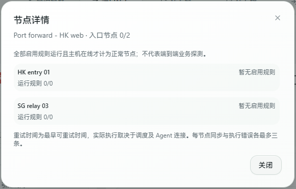

# Direct port forwarding with an entry group

Manage one logical rule across multiple entry servers, all forwarding directly to the same target. No tunnel or separate exit server is required. This does not duplicate connections or select a primary/backup entry: clients choose which entry address to connect to.

## Setup

1. Save an entry group with up to 20 hosts. Existing entry-group domain requirements remain; disable automatic DNS updates if you manage DNS yourself.
2. Create or edit a **Port forwarding** resource. Select **Entry group** as its entry type, choose the saved group and a forwarding engine.
3. Create a forwarding rule using that resource. Set the common listening port, protocol and destination.

Every enabled entry receives its own managed rule. Existing single-host resources retain their behavior. Engines use the existing per-host implementation and must be available on each host.

## Synchronization and limits

- New rules need a port in the enabled entries’ common allowed range and must pass the panel’s saved-rule conflict checks. Creation does not query live host occupancy first. A real bind conflict after saving affects that entry while healthy entries keep forwarding. Automatic allocation uses the intersection of their port policies.
- Destination, protocol, listening-port and enable-switch changes synchronize to all entries. Adding/removing members affects their corresponding listeners without resetting unchanged healthy rules.
- A newly added entry with a port conflict or disallowed port does not stop other entries. The resource shows the rule ID, host ID and reason; configuration conflicts retry approximately every 60 seconds. Offline Agents and apply failures use the existing heartbeat/retry flow.
- Resources show both healthy entry-node counts and listener counts. `4/6` listeners does not necessarily mean `2/3` healthy nodes: a healthy node must be online, not traffic-excluded, running every enabled logical rule, and free of sync errors. These counts do not guarantee end-to-end connectivity.
- Click **Node details** to open a separate dialog showing each host's state, sync attempts, recent reasons and retry eligibility. Agent execution failures have separate consecutive-failure counts. Each node shows up to three representative sync errors and three execution errors. Long content scrolls inside the dialog without stretching resource cards or table rows.
- Configuration conflicts become eligible for retry after about 60 seconds; newer Agents use an execution-failure cooldown of about 30 seconds. These are earliest eligibility times, not completion deadlines; actual execution depends on scheduling, heartbeat and connectivity. Older Agents retain existing retries but do not report detailed counts/times.
- Recent Agent tool inventories help identify missing executables on individual hosts. A missing tool on one entry-group member affects that entry instead of blocking the whole save; single-host resources retain their preflight checks. SNI uses its independent splitter capability. Offline/older Agents and reports over three minutes old remain unconfirmed. Executable presence does not prove kernel modules, permissions, runtime health or connectivity. Upgrade the Agent to report these details.
- Logical-rule traffic sums the independent entries once each. Removed entries retain their historical usage; resetting the logical rule clears that usage too.
- Rate limits apply **per entry host**, not as one distributed aggregate limit. Existing host traffic-exclusion policies still apply.
- Disable the entry group to stop its dependent rules; re-enable it to restore rules disabled by that switch. Change/remove dependent port resources before deleting their entry group.

[中文说明](./port-entry-groups.md)

*Upstream development demo (Chinese UI). Neither entry has enabled rules, so healthy entries show `0/2` and running rules show `0/0`. This is an idle-state example, not evidence of failing active rules.*

## Resource traffic totals

Cards and lists show cumulative traffic with inbound and outbound breakdowns. Port resources aggregate their linked logical rules; entry groups aggregate explicitly linked port resources, chains and tunnel rules, while exit groups aggregate explicitly linked tunnel rules. Unrelated traffic on the same hosts is excluded, and relay hops are not added repeatedly.

Totals are actual inbound plus outbound bytes, without billing multipliers or directional billing adjustments. Each independent entry counts once. Removed entries retain usage while their logical rule remains; resetting a rule updates its resource totals. Deleted rules are excluded. Administrators see all linked users' usage; other users see only their own rules.

## Runtime diagnostic logs

- Panel `[AgentTools]` logs initial inventories and changes, at least 60 seconds apart per host. `[PortEntrySync]` records changed sync errors and recovery; `[PortEntryRetry]` summarizes ongoing failures at most once per resource per 15 minutes.
- Existing `[Rule]` status lines include reported consecutive failures and retry eligibility. Repeated failures with the same running state log at most every five minutes; recovery/start transitions log separately.
- Agents log initial/changed tool discovery, desired-action retry summaries (at most every five minutes), and recovery after failure (at most every five minutes per action). Added fields contain tool names, resource identifiers and counts, not credentials or complete configurations.
