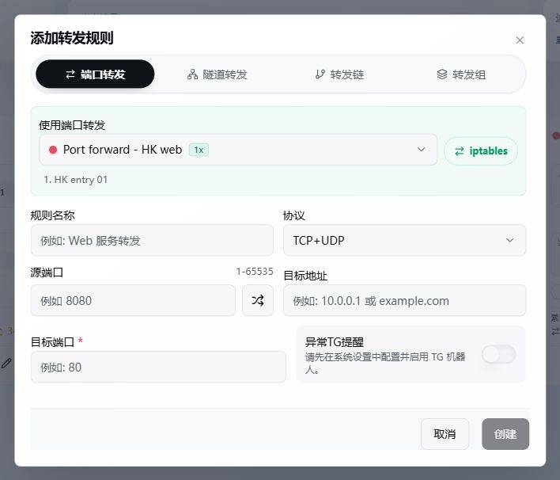

# 转发规则

转发规则定义用户实际访问的端口、协议和最终目标。端口转发、隧道、转发链和转发组先在「链路管理」中创建，规则只引用已经保存的资源。

## 添加规则

```text
转发规则 -> 添加规则
```

| 配置项 | 说明 |
| --- | --- |
| 规则名称 | 用于列表识别 |
| 使用资源 | 端口转发、隧道、转发链或转发组 |
| 协议 | TCP、UDP 或 TCP+UDP |
| 入口端口 | 用户连接的端口 |
| 目标地址 | 最终服务 IP 或域名 |
| 目标端口 | 最终服务端口 |
| 所属用户 | 规则归属、权限和计费对象 |



资源类型可以在编辑时切换。跨类型修改只保留名称、入口端口、协议、目标地址、目标端口等基础字段；原资源专属的出站策略、PROXY Protocol 或其他参数不会带到不支持它们的新资源。

## 资源类型

| 类型 | 路径 | 用途 |
| --- | --- | --- |
| 端口转发 | 用户 -> 主机 -> 目标 | 单机直连目标 |
| 隧道 | 用户 -> 入口 -> 隧道 -> 出口 -> 目标 | 加密或跨主机转发 |
| 转发链 | 用户 -> 入口 -> 中转 -> 出口 -> 目标 | 固定多跳路径 |
| 转发组 | 多入口 -> 同一目标 | DDNS 故障转移 |
| SNI 分流 | 转发链入口分流器 -> 所属转发链 -> 出口分流器 -> 落地机 | 转发链按域名选择下一跳，并可跨转发链共用一个 TCP 入口端口；隧道和单机端口转发保留各自的共用范围，详见 [SNI 分流](./sni-routing.md) |

## 端口转发工具

工具在「链路管理 -> 端口转发」中选择。

| 工具 | 说明 |
| --- | --- |
| iptables | IPv4 内核 NAT |
| nftables | 内核 NAT，适合新系统和统一规则管理 |
| realm | 用户态 TCP/UDP 转发 |
| socat | 简单用户态转发 |
| gost | 支持更多代理与转发能力 |
| nginx | 使用独立 Nginx Stream 运行时进行 TCP/UDP 转发 |

`iptables` 和 `nftables` 受协议族限制。入口和目标跨 IPv4/IPv6 时，应使用支持对应地址族的用户态工具。

## Nginx 转发

ForwardX 使用独立的 `forwardx-nginx` 运行时，监听规则配置的入口端口，不固定占用 80 端口。TCP、UDP 和 TCP+UDP 规则均可使用；是否支持某项高级参数由界面按当前模式显示。

## 状态

- **已启用**：规则配置开关已打开。
- **下发中**：面板已生成期望状态，Agent 尚未确认。
- **运行中**：Agent 已确认对应监听或内核规则存在。
- **可用**：最近一次健康探测成功。
- **异常**：Agent 执行失败、监听缺失或探测失败。
- **已停用**：用户关闭规则，或上级资源/权限受控停用。

“在线”只描述 Agent，不用于表示规则运行状态。延迟可测并不等于面板已经收到运行确认；两者会分别展示。

## 高级设置

PROXY Protocol、TCP Fast Open、流量倍率和出站策略等链路级参数在对应资源中配置。TCP Fast Open 仅在受支持的 ForwardX/GOST 路径提供；Realm 的旧 `fast_open`/`zero_copy` 选项不再生成。界面只显示当前工具支持的选项，后端仍会校验不兼容配置。

出站策略在转发规则中选择，但仅对支持该能力的隧道或端口转发工具显示。

## 搜索、分页和批量管理

### 个人分组

规则列表上方的分组栏按「全部 → 自定义分组 → 未分组」排列，右侧的管理图标可新增、编辑、拖动排序和删除分组。新增或编辑分组时，可直接搜索、分页勾选规则；取消勾选即可移出当前分组，不影响其他分组。跨页选择会保留，点击「保存」统一生效。手机端可横向滑动分组栏。

添加或编辑规则时，在「规则分组」中多选所属分组；输入名称可就地新增，旁边的管理图标可编辑或删除分组。一条规则可以同时属于多个分组。批量管理中的「调整分组」支持加入、移出或替换所选规则的分组；替换时不选任何分组即清空归属。

卡片的链路、协议和所属分组标签统一在一行，隧道路径独占下一行；没有分组则不展示。卡片直接显示一个分组，列表「所属分组」列最多显示两个，多余数量以 `+N` 显示，悬停可查看完整名称。列表分组列支持隐藏、排序和调整列宽。

分组按登录账号独立保存，仅用于整理自己的规则，与链路管理的「转发组」不同，不改变资源授权、计费或转发配置。删除分组不会删除规则，也不影响规则的其他分组。管理员查看其他用户规则时不展示自己的分组。

### 列表设置

桌面端切换到列表视图后，点击表头最左侧的列设置图标，可勾选显示列、拖动排序；规则名称和操作列始终保留；SNI 分类还保留域名列。拖动表头右侧分隔线调整列宽，双击分隔线恢复该列默认宽度，也可在设置中恢复全部默认值。

设置按账号保存，刷新或更换设备后保留，不影响其他用户。长内容截断显示，悬停查看完整信息。管理员自定义规则的额度在独立「规则额度」列中单行展示，可隐藏、排序及调宽，悬停查看详情；卡片中点击累计流量旁的信息图标查看额度与计费详情，不额外增加卡片高度。

列总宽不足时，最后一个可见列自动补齐剩余空间；超出容器时保留横向滚动，不挤压已设置的列宽。

### 分类与批量操作

规则分类依次为「全部、端口转发、隧道转发、转发链、转发组、sni规则组」。SNI 规则只在「sni规则组」中显示，「全部」和普通分类的列表、数量、分页及统计排除 SNI。分类按规则条数计数，SNI 分组按资源和入口端口组织；一个组有两条规则时，分类计为两条，翻页与拖动保持完整组。

各分类按服务端分页加载，筛选条件在数据库执行。基础规则先显示，流量和实时状态随后补充；不会先下载全部规则再在浏览器切页。在 SNI 分类选择具体资源后仍保留当前分类；搜索、用户和资源筛选以及顶部全部页汇总使用相同范围。

批量管理在需要时读取完整筛选结果，支持：

- 按名称、端口、目标、用户和资源筛选。
- 多选或全选筛选结果。
- 复制到其他端口转发、隧道、转发链或转发组。
- 批量修改资源、目标地址和目标端口。
- 导入、导出和删除。

跨资源复制只保留目标资源支持的字段。复制前核对弹窗中的目标资源与所属用户，右侧选择的是复制目的地，不是原规则筛选条件。

批量来源支持「sni规则组」。查看分类不改变规则实际绑定的资源，复制目的地、导入与导出仍使用真实资源类型。

批量新增时，配套新版 Agent / FXP 可为 GOST、V1/V2 共享运行时增量增加监听，减少已有规则断连；端口冲突或增量接口不可用时会报告失败，不通过重启已有监听强行完成新增。该保护不涵盖修改/删除现有监听、升级二进制或运行时故障恢复。

## 列表详情与延迟测试

3.6.0 起采用上游可配置表头：所属用户、个人分组、链路、额度、24H、开关等可按当前账号布局显示。SNI 规则列表另外保留域名和当前／备用入口，普通规则按各自的资源和路径显示。点击「所属资源」展开简约文字，链路标题加粗，用户跟在链路之后。

累计列显示流量和「详细」。详情保留入向、出向、统计方向、规则额度已用和额度；累计总流量与额度已用使用各自说明的统计口径，使用 MB／GB 形式展示不改变计费方式。

列表的「更多」依次包含「24小时流量、链路自测、重置统计、删除」。24 小时详情分别显示入向和出向，保留延迟历史；重置与删除继续受现有权限和确认流程约束。

点击「未测」或已显示的延迟会立即开始测试，不弹窗；完成、失败或超时后均可再次点击。同条规则测试中不能重复发起，收起分组或切换分类保留本次测试状态。修改配置或重置统计后不会把旧结果当作当前结果；需要完整诊断时，从「更多 → 链路自测」打开原弹窗。

## 普通规则批量导入

在“批量管理 -> 批量导入 -> 手动输入”中，先选择要使用的端口转发、隧道、转发链或转发组，再按行填写规则。同一批可以混用以下两种格式：

```text
规则名称#源端口#目标地址#目标端口
官网#10443#example.com#443
内网服务#18080#10.0.0.8#8080
IPv6服务#18443#[2001:db8::1]#8443
example.net:443
[2001:db8::2]:8443
```

第一行是格式说明，不要把它作为规则一起导入。四段格式保存填写的规则名称和源端口，例如“官网”把所选入口的 10443 转发到 example.com 的 443。名称不能包含分隔符 `#`；源端口和目标端口均填写 1–65535 的十进制整数，IPv6 地址使用方括号。

原来的 `地址:端口` 格式继续使用，名称按目标地址生成，源端口随机分配。混用时先完成指定源端口的规则，再处理随机端口规则，避免随机规则抢走同批指定的端口；预览和失败结果仍按原输入顺序显示。单次最多导入 500 条，空行不计入数量。

指定源端口与已有规则冲突或超出资源、套餐允许范围时，该条报错，不自动改成随机端口。一条失败不撤回其他成功项，输入框只留下失败规则的完整原文，修改后可以再次导入，已经成功的条目不会重复提交。保存成功后仍需等待入口确认实际运行。

SNI 分流使用单独的“SNI 分流”模式和统一入口端口，其四段格式为 `规则名#SNI域名#目标地址#目标端口`，详见 [SNI 分流](./sni-routing.md)。

## 规则归属与统计重置

管理员新增、复制或导入规则时，新规则归当前选择的用户。选择“我的规则”或“所有用户”时，新规则归管理员本人；编辑已有规则不会改变归属。目标用户的资源授权、套餐状态、余额、端口范围与额度仍须满足要求。

“重置全部统计”按当前用户范围执行：选择自己只重置自己的规则，选择指定用户只重置该用户，选择“所有用户”重置全部用户。普通用户仅能重置自己的规则。操作包含其他分页，不受搜索、链路、规则类别或勾选影响，不修改账户套餐已用流量、余额及计费记录。

编辑时的可用端口范围由服务端合并主机、隧道、转发组和用户套餐限制。SNI 规则强制使用 TCP，同一用户的多条域名规则分别占规则额度，共用的入口端口只占一个端口名额。停用规则仍计入额度，重新启用不会再次占用名额。

### ny / Nyanpass 导入（实验性）

在「转发规则 → 批量管理 → 批量导入」中，上传 ny 批量导出的逐行 JSON 文件（`.json`、`.jsonl`、`.ndjson` 或 `.txt`），或选择「ny（实验性）」粘贴导出内容。也接受单个 JSON 对象或 JSON 对象数组；不支持旧版 `名称#端口#目标#端口` 文本及完整数据库备份。

1. 先创建并选择 ForwardX 中的目标端口转发、隧道、转发链或转发组。不会导入 ny 的服务器、入口/出口组、账号、凭据或历史流量。
2. 明确选择 TCP、UDP 或 TCP+UDP。ny 批量导出不含完整的协议、暂停状态与拓扑，不能据此自动还原原链路。
3. 核对所有目标地址、监听端口、PROXY 选项、出站策略及限速预览，勾选实验性说明后导入。
4. **所有 ny 规则导入后均停用**，确认配置后手动启用。不覆盖已有规则；指定端口冲突或超出范围时保留为失败项，不静默改成随机端口。`listen_port: 0` 才表示按目标资源的端口策略自动分配。部分失败只保留失败规则供重试，不重新提交成功项。

兼容范围：

| ny 字段/配置 | 首版支持情况 |
| --- | --- |
| `name`、`listen_port`、单个 `dest` | 支持 IP、域名、`[IPv6]:port`，继续执行目标资源权限与端口校验 |
| 多个 `dest` | 最多 11 个，仅支持 TCP 的 GOST 普通端口转发资源 |
| `dest_policy` | `random`、`round`、`ip_hash`、`failover` 转为 ForwardX 对应策略；探测和切换时间仍使用 ForwardX 机制，不保证与 ny 完全一致 |
| TCP PROXY | `accept_proxy_protocol: 1`、`proxy_protocol: 1/3` 仅支持 TCP 的 GOST/Realm 普通端口转发资源；资源 PROXY 配置必须已匹配，不自动修改共享资源 |
| `speed_limit` | 管理员可导入可精确换算为整数 Mbps 的限速（125000 bytes/s = 1 Mbps）；仍需满足单规则限速的 Agent 版本要求，带限速规则沿用管理员管理权限 |
| UDP PROXY、`least_load`、TLS/SNI 子规则 | 暂不支持，明确报错 |
| 非零 `ip_limit` / `connection_limit`、其他未知字段 | 暂不支持，明确报错，不静默丢弃 |

普通单目标规则可以选择其他资源；存在 PROXY 配置不一致时会阻止导入，避免意外添加或移除 PROXY 头。导入仅转换配置，不提供 ny 节点协议互通或无缝迁移保证。建议先导入少量规则验证，再迁移剩余规则。

[English: experimental ny import](./nyanpass-import.en.md)

## 排序

分类列表支持拖动排序，保存时携带当前页起始位置。第二页排序不会覆盖第一页。“全部”视图按各分类已保存的顺序展示，不提供跨类型拖动。

## mimic UDP 混淆

mimic 只用于 ForwardX 隧道，且规则协议需要包含 UDP：

- V1：处理 FXP 的 UDP 承载。
- V2：处理 userspace WireGuard 的外层 UDP。
- TCP 仍走原 TCP 通道，不与同端口 UDP 混淆处理互相替代。

参与链路的 Agent 主机需要安装 `mimic`/`mimic-dkms`。Agent 安装脚本提供可选安装，默认不安装；也可以手动执行：

```bash
curl -fsSL https://raw.githubusercontent.com/owo10086/sni-panel/main/scripts/install-mimic.sh | sudo bash
```

ForwardX 安装器默认安装或升级到 `mimic v0.7.1`。该版本仍要求 Linux 6.1+、XDP 入站和 TC 出站 eBPF 钩子；Agent 会在 XDP `native` 与 `skb` 模式之间自动回退。发行版没有对应二进制包时，上游安装器会尝试源码构建。

Agent 会只读检测 mimic 命令和内核模块，并把结果上报给面板。开启 UDP 混淆、重新启用隧道或更换链路主机时，面板会逐台校验；缺少环境时本次操作失败并提示手动安装，Agent 不会自行安装。

mimic 依赖 Linux 内核、XDP 入站和 TC 出站能力，只改变 UDP 包外观。它不会修复线路本身的丢包、抖动或 NAT 限制。

## 单条规则限额与有效期

管理员可为单条规则配置限速、流量额度、计量方式（仅出向、双向合计或两方向累计值的最大值）、创建时间和到期时间；网页配置默认收起。0 或留空表示不限速/不限量，到期时间留空表示无独立期限；账户限制仍同时生效。创建时间仅作记录，修改日期不重置流量。达量或到期后规则暂停，管理员提高/清除额度或延长到期时间后可恢复；普通用户不能修改这些限制或自行重置限额规则的流量。

“规则即将到期”按规则与所属账户期限中的较早时间查询，并在结果中标注来源。未指定时间范围时，到期查询默认未来7天、不含已到期；规则流量排行使用当前累计入向加出向流量，不代表某一天的用量。首次设置额度时以规则当前累计统计建立基线，后续用量保存在逻辑规则上，切换链路、重建成员、普通启停或修改创建日期不会重置。

管理员重置规则统计时会同时清零该规则已用额度，因额度用尽而暂停的规则在账户和其他运行条件允许时可能恢复；重置不会改变规则到期时间，也不会重置账户套餐已用流量、余额或按量计费记录。“全部统计”覆盖当前用户范围的所有分页，不受搜索、链路、分类或勾选影响；普通用户执行时会跳过管理员自定义规则。规则流量额度与可创建的规则数、端口数及账户套餐流量分别计算。

额度和到期暂停依赖面板与 Agent 通信，离线 Agent 要等恢复同步后才能应用。普通非 SNI 规则在入口限速，多入口按每台入口主机独立执行，入口 Agent 需要 2.2.187 或以上；SNI 单机、转发链和直接隧道在最终出口执行；主机型转发组由各成员分别执行，用量按现有方式汇总。旧连接和 DNS 缓存可能让多台成员同时服务，不能理解为全组严格共用一个连接上限。

单条规则限额也适用于管理员本人名下的规则。管理员可以在“我的规则”中新建或编辑规则，展开“限额与有效期”，为提供给他人使用的不同规则分别配置限速、流量额度、计量方式和到期时间，无需单独创建用户账户。达量或到期只暂停受限规则（含其转发组成员），不影响本人其他正常规则；管理员可以修改限制或重置对应规则用量。

管理员为用户创建或配置单规则限额的规则属于管理员自定义规则。用户可在规则卡片和列表中查看已用流量、额度、剩余额度与计量方式，但不能编辑、启停、删除、排序或重置；机器人操作也遵守相同权限。清空额度或有效期不会解除只读限制。普通用户自行创建的普通规则不受影响；批量重置全部数据会跳过管理员自定义规则，管理员仍可重置其用量。

管理员选择用户后，添加和批量管理按所选用户执行；默认“我的规则”，在“所有用户”视图新增时归属管理员本人。保存前核对所属用户和当前资源权限。

## 排障

规则创建后可使用自测或 TCPing。失败时按顺序检查：

1. 所属 Agent 是否在线且版本满足资源要求。
2. 规则是否已启用，是否仍在下发。
3. Agent 日志中是否有端口占用、运行时失败或权限错误。
4. 安全组和防火墙是否放行 TCP、UDP 或两者。
5. 目标地址和端口是否能从实际出口主机访问。
