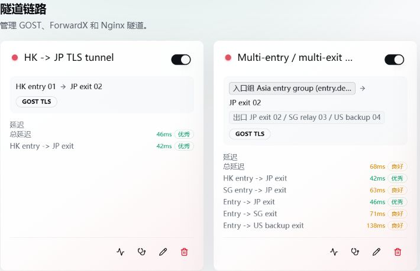

# 隧道链路

隧道连接入口与出口主机，适合跨主机转发、加密链路、多跳和多出口场景。

```text
用户 -> 入口 -> 隧道 -> 出口 -> 目标
```

配置入口：

```text
链路管理 -> 隧道
```



## 隧道类型

| 类型 | 说明 |
| --- | --- |
| GOST | 使用 TLS、WSS、TCP、MTLS、MWSS 或 MTCP 等 GOST 模式 |
| ForwardX V1 | 使用 AES-256-GCM 认证加密的 FXP 传输 |
| ForwardX V2 | 外层使用 Agent 内置 userspace WireGuard，内层继续使用 FXP |
| Nginx Stream | 使用独立 Nginx 四层运行时，支持 TCP/UDP；TCP 可选 TLS 证书 |

## ForwardX V1 与 V2

| 版本 | 传输 | 兼容性 |
| --- | --- | --- |
| V1 | FXP AES-256-GCM TCP/UDP 加密通道 | 已有隧道继续使用 V1，不会自动切换 |
| V2 | userspace WireGuard 外层 UDP + FXP 内层 | 需要链路内 Agent 均满足界面要求的最低版本 |

V2 不依赖系统 `wg` 命令，不创建系统 WireGuard 网卡，也不修改系统路由。每个隧道在每台 Agent 上复用一套 WireGuard 运行时，规则通过本机回环代理接入。

V2 支持单跳、多跳、入口组、多出口、TCP/UDP、限速、PROXY Protocol 和链路测试。使用前确认所有节点的防火墙和安全组放行 WireGuard UDP 端口；端口可手动填写，留空时由面板分配。

V3 底层已纳入本地源码，但网页和直接请求接口都不开放创建或切换 V3；已有 V1／V2 不转换。版本号相同也不能代替两端实际兼容确认，见[运行兼容](./releases.md#运行兼容)。

## GOST

GOST 模式的物理承载和业务规则协议不是同一概念。TLS/WSS/TCP 等隧道承载通常监听 TCP，业务规则仍可按模式能力传输 TCP、UDP 或 TCP+UDP。面板和 Agent 的就绪检查以实际承载监听为准，不会要求不存在的 UDP 物理监听。

## Nginx Stream

Nginx 仅保留 Stream 模式：

- 支持 TCP、UDP 和 TCP+UDP 四层转发。
- TCP 可配置证书和私钥启用 TLS；UDP 不使用 TLS。
- 使用独立 `forwardx-nginx` 二进制、配置目录和服务。
- 监听隧道配置中的端口，不固定占用 80 端口。
- 适合出口组负载均衡，不等同于 ForwardX 自定义加密隧道。

隧道模式只接受当前的 `nginx_stream`。旧 `nginx_tls` 数据不再由运行时自动转换，跨版本升级时请先按[升级和备份](./upgrade-backup.md#跨兼容边界升级)执行一次性迁移。

### 拖放导入 TLS 证书

在 Nginx Stream 隧道的证书配置区域，可点击「拖放或选择证书文件」，也可将文件拖入该区域：

1. 准备 PEM 编码的证书链和对应的未加密私钥。证书链放在一个文件内，服务器证书在前，中间证书在后；不要上传两个独立证书文件让页面猜测顺序。
2. 一次选择最多两个文件（一个证书链、一个私钥），或选择同时包含证书与私钥的单个 PEM 文件。也可以分次导入，未导入的另一项会保留。
3. 核对证书域名 / SNI 和导入后的文本，再保存隧道。读取成功只说明文件已填入表单，不代表证书与私钥匹配、域名有效或 Agent 已加载成功。
4. 检查 Agent 的 Nginx 运行状态，并通过实际 TCP TLS 连接验证。UDP 不使用这套 TLS 证书。

证书内容、私钥各最多 64 KiB，所选文件总大小最多 128 KiB。不支持二进制 DER、PFX/P12 或需要输入密码的加密私钥。文件先在浏览器内解析，保存后随配置提交；不要将私钥放入文档、公开截图或日志。

这里是业务隧道证书，不是面板网页 HTTPS 证书；网页 HTTPS 见 [反向代理与 HTTPS](./reverse-proxy.md)。

## 多入口、多跳和多出口

- **多入口**：先创建入口组，再由隧道引用。
- **多跳**：按真实网络路径排列中继节点，并为每跳选择连接地址。
- **多出口**：直接添加额外出口，或引用保存的出口组。
- 连接地址留空时使用主机默认入口；也可指定内网 IP、IPv6 或域名。

使用出口组时，规则列表显示出口组名称并列出实际出口节点，不用第一台出口主机替代组名。

## 状态

| 状态 | 含义 |
| --- | --- |
| **已启用** | 隧道配置已打开 |
| **运行中** | 当前角色所需运行时和监听已就绪 |
| **可用** | 最近一次独立隧道探测通过 |

没有新鲜探测时，界面根据必经主机和可选出口的在线状态判断基础可用性。

隧道状态不与引用它的转发规则数量或运行状态绑定。多出口中至少一个出口探测成功时，整体可保持可用，失败出口在分支明细中单独展示。

## 引用规则与流量汇总

隧道卡片、手机端列表及桌面表格展示引用规则数、累计流量、入向和出向。引用数按逻辑规则去重，包含停用规则，不包含待删除规则；通过转发组间接引用的规则也计入，多个入口不会把同一规则算成多条。

流量使用关联规则的累计实际字节，入向加出向，不使用计费倍率，也不按隧道中继跳数重复累计。转发组的不同隧道成员仅汇总各自对应的规则流量，不把整组流量重复计入每个隧道。重置规则流量后，汇总在下次查询时更新；无引用时显示 0，请求数据不可用时显示「—」。

管理员查看全部关联规则，普通用户仅查看自己的引用数和流量；资源已授权不代表可以查看其他用户的统计。

## 高级设置

界面按隧道类型显示 PROXY Protocol、TCP Fast Open、流量倍率、出站策略和传输参数。TCP Fast Open 仅在 ForwardX 隧道的受支持路径提供；Realm 的旧 `fast_open`/`zero_copy` 选项不再生成。未显示的参数不受当前类型支持。

修改隧道拓扑后，面板会生成新的拓扑标识；旧拓扑迟到的探测结果不会写入新图表。

## mimic UDP 混淆

mimic 在物理网卡使用 XDP ingress 与 TC egress，需要 Linux 6.1+ 内核；Agent 会在 XDP `native` 与 `skb` 模式之间自动回退。mimic 来自 [hack3ric/mimic](https://github.com/hack3ric/mimic)（GPL-2.0-only，v0.7.1）：

- V1 对 FXP UDP 承载应用 `remote/local` filter。
- V2 对 WireGuard 外层 UDP 端口应用 filter。
- 多跳和额外出口按每条物理链路分别配置。
- TCP 通道保持原路径，不会因开启 UDP 混淆改为 mimic。

参与节点必须安装 `mimic`/`mimic-dkms`。面板优先使用主机中配置的网卡，否则使用 Agent 上报的默认路由网卡。安装失败或内核不支持时，面板会显示 Agent 返回的原因，Agent 不会自行安装环境。

## 创建后检查

1. 确认所有链路节点 Agent 在线。
2. 检查每跳连接地址、承载端口和防火墙。
3. 运行链路测试并查看具体失败分支。
4. 查看 Agent 日志（`/var/log/forwardx-agent/`）中的运行时应用、监听和握手错误。
5. 只有 UDP 异常时，分别测试原生 UDP、V1/V2 承载和 mimic 配置，避免把 TCP 可达当作 UDP 已通。
