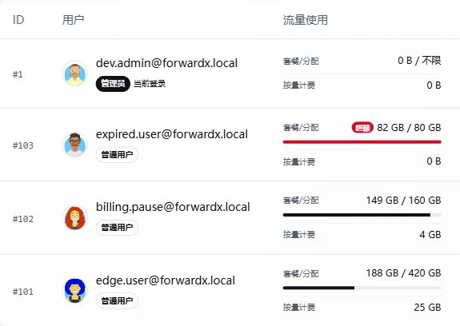

# 用户、套餐和权限

管理员可以在面板中管理用户和套餐。

常见功能：

- 创建用户。
- 设置用户到期时间。
- 设置流量额度。
- 设置最大规则数、端口数。
- 分配可用端口转发、隧道、转发链或转发组资源。
- 配置套餐和价格。
- 配置余额、兑换码、折扣码。
- 配置邮件提醒或 Telegram / Discord 通知。

## 新手建议

如果你只自己使用，可以先不用配置复杂套餐，只保留管理员账户和基础规则即可。

如果要开放给用户使用，建议先规划：

- 每个用户最多可以创建多少规则。
- 每个用户最多可以使用多少端口。
- 每个用户能使用哪些端口转发、隧道、转发链或转发组。
- 流量超额后如何处理。
- 到期前是否发送提醒。

## 权限分配

先创建并验证资源，再在「用户管理 → 目标用户 → 授权」配置使用范围：

1. 普通端口转发选择「端口转发授权」中的资源。
2. 转发链、转发组和隧道在各自的授权区域选择，不要把组成员主机授权当作整组授权。
3. 按需设置用户到期时间、流量额度、规则数和端口数；资源可见不代表这些账户限制被取消。
4. 保存后使用普通用户账号核对可选资源，并创建一条测试规则验证实际 TCP/UDP 业务。

用户自有资源、管理员手动授权和有效套餐授予的资源共同决定可用范围。只授权需要的资源；不要为了让一条规则可用而开放全部主机和链路。

### 网络测试主机权限

「网络测试主机授权」只用于增加网络测试可见主机。普通用户可看到自己创建、通过主机授权或有效套餐授权获得的主机；端口转发、转发链、转发组或隧道的成员主机，不会仅因链路使用权限而单独出现在网络测试列表。

因此，能使用某条链路与能在网络测试中选择其中每台机器是两件事，不需要为使用链路额外开放所有成员主机。

### 修改或撤销授权

用户原有的逻辑规则仍应保留在自己的列表中；失去资源授权后停止转发，并提示重新选择资源，不应直接隐藏或删除规则。用户可以编辑规则，改为当前有权限的端口转发或隧道后继续使用；管理员管理的只读规则仍遵循原有操作限制。

若授权变更后规则完全消失，先核对规则所属用户、筛选条件及面板版本，不要直接删除数据库记录。

## 按流量计费资源

按流量计费产品的「需要授权」决定是否还需管理员单独放行：

| 设置 | 用户使用条件 |
| --- | --- |
| 不需要授权 | 启用的计费资源可按产品规则使用，无需再手动共享同一资源 |
| 需要授权 | 管理员先为该用户授予对应计费资源权限，之后才可使用 |

两种情况仍受产品启用状态、用户状态、余额/信用额度及其他限额约束。「不需要授权」不是免费使用，也不等于授予成员主机的管理权限。配置后分别用未授权和已授权的普通账户验证资源列表及创建规则结果。

## 流量统计与重置

用户列表中的“流量使用”分为两项：

| 统计项 | 含义 |
| --- | --- |
| 套餐/分配 | 用户套餐或管理员分配额度内的已用流量，用于额度和超额状态判断 |
| 按量计费 | 按流量计费规则累计的使用量，便于单独核对计费流量 |



管理员可在目标用户的“更多”菜单中选择“重置流量统计”。手动重置会把页面显示的套餐/分配流量和按量计费流量都从零重新统计，但不会撤销已经产生的扣费记录，也不会修改用户余额。

套餐的定时重置仍只重置套餐/分配流量，不会改变按量计费统计。需要同时重新统计两项时，应使用用户列表中的手动重置操作。

## 单 IP 接入限制

用户配置中的「单 IP 接入限制」是**每个来源 IP 的 TCP 并发连接上限**，不是允许多少个不同 IP。0 表示不限制；UDP 不适用。

| 路径 | 范围 |
| --- | --- |
| 普通端口转发（iptables / nftables / Realm / Socat / GOST / Nginx，含 Guard 包装入口） | 同一用户、同一入口主机的规则共享上限 |
| ForwardX V1 / V2 普通隧道 | 按规则计数，保持已有隧道限额语义 |
| 所有 SNI 分流及其成员副本 | 排除本轮新增的普通端口限制，沿用既有规则最大连接数 |

普通端口限制需要配套新版 Agent，以及主机可用的防火墙工具与内核能力。只限制新建 TCP 连接，不主动踢掉已有连接；新增规则不重置计数，设为 0 或移除规则会清理限制。已生效的非零账户或套餐设置会在具备能力的新 Agent 上开始约束普通转发。能力不足时 Agent 会明确报错并保留转发，不要将“转发还通”误认为限制已生效。

## 套餐展示说明

套餐管理页直接展示「订阅套餐」「按量计费资源」，不再展示顶部数量和账务汇总卡片。右上角「设置」可管理「商店状态」「按量计费」总开关，修改后立即生效；各套餐及计费资源自己的启用、商店展示和授权要求仍单独配置。公开计费资源可在余额充足时使用，需要授权的资源仍须先获得授权。

扣费记录和余额流水在 [账单与兑换](./billing.md) 查询；日期范围、用户范围内的账务汇总在 [运维看板](./operations.md) 查看，不在套餐配置页重复展示。

1. 在套餐管理设置价格、购买时长、额度、规则/端口限制和实际授予的资源。
2. 核对是否启用及是否允许在商店展示，再使用普通账户检查购买入口。
3. 购买或兑换后，检查用户的生效订阅、资源权限和额度，不只检查付款页面。

说明留空时显示系统生成的套餐权益；填写后在管理列表、卡片与商店显示自定义内容。新增套餐默认填入可修改的 Markdown 小模板，编辑已有套餐不会覆盖原说明，卡片和列表的铅笔图标用于编辑。

说明支持普通文本换行、Markdown（标题、列表、加粗、引用、代码和链接），也支持安全的 H5/HTML 标签（如 `div`、`h3`、`p`、`ul`、`strong`、`a`、`table`）。点击说明旁的「预览」可检查效果，最多 10,000 字符。HTML 与 Markdown 自动识别，建议单次使用一种格式；脚本、事件处理器、嵌入页面和自定义样式会过滤，不支持执行 JavaScript 或完整网页应用。

例如，可将默认模板改为：

```md
## 日常转发套餐
- **线路特色**：填写实际节点与线路介绍
- **使用额度**：填写实际流量、端口与速率
- **售后支持**：填写联系方式

> 购买前请确认套餐权益和使用规则。
```

说明不会改变真实价格、权限、额度或计费规则。管理员应确保展示与实际配置一致。

支付配置见 [支付对接](./payments.md)，订单、余额、兑换码和折扣码见 [账单与兑换](./billing.md)，提醒配置见 [通知与机器人](./notifications.md)。
